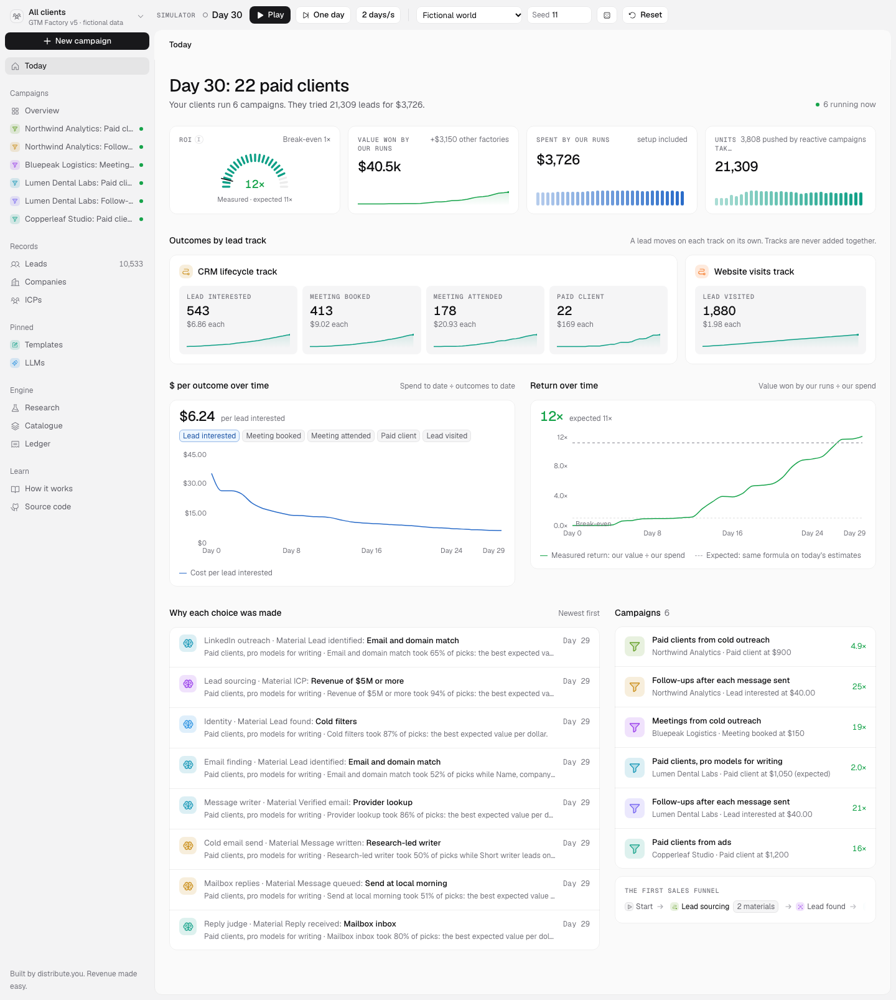

# GTM Factory v5

An open framework for running go-to-market as an agentic factory, in a plant's own words: Campaigns order a Target, legs make outcomes, scripts compete inside each leg (rules, AI, people) each with its own Bill of materials, every Unit lands in one ledger that is the common stock, and a Supplier rating makes every choice with the best value per dollar. The production tree is rebuilt at every tick from performance.

Built by [distribute.you](https://distribute.you). Revenue made easy.

**Live dashboard: https://distribute-you.github.io/gtm-factory/** (fictional data, runs in your browser)

[](https://distribute-you.github.io/gtm-factory/)

## What it is

- **A model.** Three objects carry a status: outcomes, legs and scripts. An outcome is a part reference; a Unit is one piece of it. A leg goes from one outcome to another; each script performing it declares its own Bill of materials, the outcomes it consumes per Unit produced, one Material per line. Tactics (typed: yes/no, a list, a number) and strategies (conditions per Material) describe them. Scripts and brand Units (templates, ICPs) live in dynasties of versions. Everything is data.
- **Pull and push, on a tree rebuilt every tick.** A Campaign fixes only its Target, its budget, its start and its strategy ("Channel is cold email"). From Start it pulls from the Target down, most advanced Units first; from any other outcome it pushes each Unit that lands up toward the Target. Every leg runs the same code: pick a script, serve each Material from the stock with its Specification (subject, conditions, quantity), else pull that outcome from the best producer, then run. The sales path and the sales funnel are views of the tree. Every Run is one script executed: one Unit or none.
- **A Supplier rating.** An auxiliary cost center that reads the ledger and the traceability and makes, each tick, the Rating every choosing script consumes: Thompson sampling on value per dollar, pooled from the script's level everywhere down to the client, with delay censoring and measured costs. Every Unit carries its traceability, so every choice is credited when the next lead state lands.
- **A ledger.** The common stock of every Unit, from every producer. Decisions read each candidate's own cost; reports read the every-path ledger, reconciled to the cent.
- **A simulator.** A fictional world published as data, with a hidden truth, played tick by tick, so you can watch every choice converge.

Read the spec: [docs/framework.md](docs/framework.md).

## Repository

| Path | What |
|---|---|
| `packages/engine` | The framework's code: catalogue, pull and push, ledger, Supplier rating, simulator. TypeScript, zero runtime dependencies, pure and deterministic. |
| `seed/fictional-world.json` | The fictional world: catalogue, clients, market and hidden truth. Every scenario number lives here. |
| `seed/distribute-catalogue.json`, `seed/distribute-world.json` | distribute.you's public catalogue (no production figure, no price) and the "distribute.you catalogue" scenario built on it, fictional clients and numbers. |
| `packages/scenarios` | The translation of distribute.you's public catalogue into the model (a channel is a tactic, each channel's script carries its own Bill of materials) and the scenario builder. |
| `docs/framework.md` | The framework, in plain English, with worked examples checked by tests. |
| `apps/dashboard` | The live dashboard: the whole product on the simulated world, in the browser. Next.js static export, deployed to GitHub Pages on every push to `main`. |
| `docs/screenshots/` | One screenshot per dashboard page after 30 simulated days. |

## Quick start

```bash
pnpm install
pnpm -r typecheck
pnpm -r test
```

```ts
import { readFileSync } from "node:fs";
import { SimulationSession, convergence, shareOnBest, worldFromData } from "@gtm-factory/engine";

const world = worldFromData(JSON.parse(readFileSync("seed/fictional-world.json", "utf8")));
const session = new SimulationSession(world);
session.run(60);
for (const point of convergence(session)) console.log(point.point, shareOnBest(point, 50, 60));
```

## The dashboard

Open the [live site](https://distribute-you.github.io/gtm-factory/), press **Play**, and watch fictional clients win paying clients. Every page reads the framework's code:

| Page | What you see |
|---|---|
| Today | Return measured beside expected on one formula, value won by our runs beside other factories, outcomes per lead track, why each choice was made. |
| New campaign | Pick a client, a Target and a start (Start, or an outcome whose Units the campaign pushes), see the sales funnels its tree can run by value per dollar, choose strategies per leg, set a budget, launch. |
| Campaigns | Each campaign's Goal (its Target), proactive or reactive, its strategy and budget, its sales funnel and sales path (views), every leg with a "materials" badge opening its script's Bill of materials, each step's cost and cost from Start, the production tree with each branch's share and cost, and every choice titled "Leg · its script" or "Leg · Material", beliefs beside the hidden best. |
| ICPs | Competing ICP sentences per client, the finer ones the splits proposed, and the verdict of every split. |
| Leads, Companies | A board per lead state and track; each lead's timeline with the traceability of every Unit. |
| Pinned pages | Pin any outcome or leg: Templates and LLMs ship pinned. Read, edit (a new version) and compare versions; scripts as cards; each script's Bill of materials, where the leg is plugged and the best script at each Material; its leg storage. |
| Research | Convergence of every choice point toward the hidden best candidate, beliefs beside the hidden truth, strategies proposed by splits. |
| Catalogue | Outcomes, legs, scripts with their Bill of materials, sales paths and funnels (views), tactics, strategies and factories. Upgrade, fork, retire, pin. |
| Ledger | Every-path unit costs beside each leg's own cost, our spend beside other factories', reconciled to the cent. |
| How it works | The framework's core ideas, linked to the spec. |
| Api data source | Build with `NEXT_PUBLIC_DATA_SOURCE=api` and the same dashboard runs a real factory through the factory API: brands, campaigns with a daily cap, leads, templates, LLMs, research and the ledger. See [docs/api.md](docs/api.md). |

Run it locally:

```bash
pnpm install
NEXT_PUBLIC_BASE_PATH="" pnpm --filter dashboard dev     # http://localhost:3000
pnpm --filter dashboard build                             # static site in apps/dashboard/out
pnpm --filter dashboard screenshots                       # render check: every page, day 30
```

## License

MIT, see [LICENSE](LICENSE).
