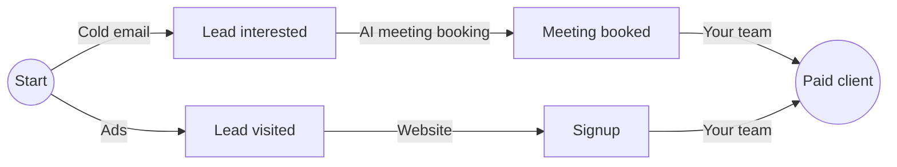
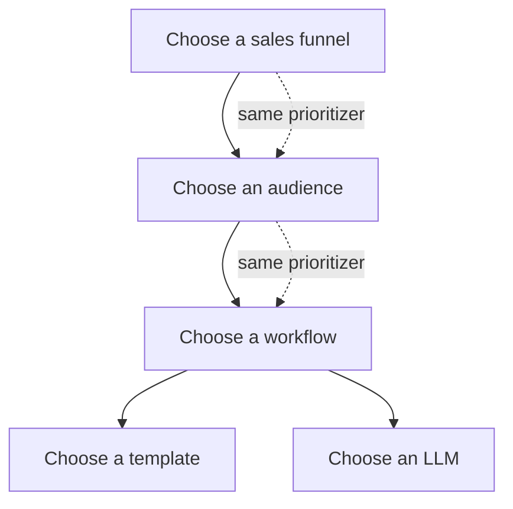

# GTM Factory: the framework

Revenue made easy. This document describes the open framework behind it: how to model a go-to-market operation as a factory, how the engine decides where every dollar goes, and how it learns from what happens. Everything here is implemented in [`packages/engine`](../packages/engine), and every number in the worked examples is checked by a test.

## 1. The factory

Think of a car plant. Raw material comes in, stations transform it, finished cars roll out. Each station has a cost per unit it processes and a share of units that come out good. The plant manager does not ask "which station is cheapest?" but "which line produces a car for the least money, and is a car worth more than that?"

Go-to-market works the same way. The raw material is a market. The finished product is a paying client. In between, stations turn one state of a buyer into the next: a found lead becomes an interested lead, an interested lead books a meeting, a meeting becomes a client. Some stations are software, some are AI, some are people. Some are run by the platform, some by the client's own team. All of them cost money and all of them convert at some rate.

The framework names these stations, measures them, and picks the line with the best value per dollar spent. It does so with one algorithm, at every level, and it never stops learning.

## 2. The objects

Everything is data. Nothing in the engine knows the name of a channel, a pipe or a step: add a new one and it competes like the others.

| Object | What it is |
|---|---|
| **Step / Outcome** | A state a lead reaches once per lead and brand (lead interested, meeting booked, meeting attended, paid client, lead visited), or an object made (audience built, post published). |
| **Lead track** | An ordered ladder of lead states. "CRM lifecycle" runs lead interested, meeting booked, meeting attended, paid client. "Website visits" holds lead visited. A lead moves forward on each track separately, and tracks are never added together. A new track is declared like any other object. |
| **Trigger** | What wakes a reactive pipe: an outcome reached, or a condition about a lead ("Lead event" = any fact about a person). |
| **Channel** | A way to reach or move people: cold email, ads, a website, your team. |
| **Pipe** | A channel on one leg, from one step to another. Proactive pipes spend their own budget. Reactive pipes wait on one trigger. |
| **Sales path** | A chain of legs from Start to Paid client. |
| **Sales funnel** | A straight line along a sales path: exactly one play per leg. A human leg is a "Your team" channel. |
| **Tactic** | A yes or no tag on a workflow, a template or an LLM ("researches the company first"). |
| **Strategy** | Tactics required and tactics excluded. |
| **Play** | A pipe with a strategy. An empty strategy is the pipe's default play. |
| **Workflow** | How a pipe is performed: by rules, by AI, or by a person. It declares slots it needs filled, such as a template and an LLM. |
| **Template dynasty, LLM dynasty** | The options a slot can take, each improved over versions. |
| **Client** | An org, its brands, and each brand's offers. |
| **Offer** | The steps its business has (a consulting firm has no signup step) and its lifetime revenue. |
| **Audience** | A described group of leads, written by an expert from the client's ideal customer profile or found by the data. |
| **Campaign** | A running sales funnel with a maximum budget, a maximum volume, or both. |
| **Run** | A production order: it consumes occurrences, produces occurrences, and has a cost. |
| **Occurrence** | One outcome reached by one subject. The only thing that carries cost. |
| **Ledger** | Every run and occurrence, with the arithmetic that prices them. |
| **Choice node** | Any place where the engine must pick: a funnel, a play, an audience, a workflow, a template, an LLM. |
| **Universal prioritizer** | The one algorithm that decides at every choice node. |

## 3. Two calculations

Every decision rests on two numbers that flow in opposite directions.

**Cost flows forward from Start.** One occurrence of a step costs what it took to make the inputs, plus the station's own cost, divided by its yield:

`C(start) = 0` and `C(to) = (C(from) + c) / y`

where `c` is the pipe's cost per input processed and `y` the share of inputs that reach the next step.

**Value flows backward from the target.** A paid client is worth the offer's lifetime revenue. A step before it is worth what you can make of it, net of what that costs, or nothing if the best option loses money:

`V(target) = value` and `V(s) = max(0, max over plays leaving s of y x V(to) - c)`

This is Bellman's equation. It tells you, at every step, which play to run and how much one more occurrence there is worth.

For a whole funnel, the cost of one target outcome is

`T = c1 / (y1 y2 ... yn) + c2 / (y2 ... yn) + ... + cn / yn`

and its value per dollar is `value / T`. A funnel is worth funding when its value per dollar is above 1.

### Worked example

A client sells a service with a lifetime revenue of **$2,100**. Two sales funnels lead to a paid client.

Funnel A, through a meeting:

| Leg | Cost per input | Yield |
|---|---|---|
| Start to Lead interested (cold email) | $1 | 2% |
| Lead interested to Meeting booked (AI meeting booking) | $2 | 40% |
| Meeting booked to Paid client (your team) | $10 | 20% |

Cost forward: one interested lead costs $1 / 0.02 = **$50**. One meeting costs ($50 + $2) / 0.4 = **$130**. One paid client costs ($130 + $10) / 0.2 = **$700**.

Read per paid client, the same $700 splits by leg. Each leg's count of inputs per paid client is its **leads needed**: the closing leg needs 5 meetings at $10 (**$50**), the booking leg needs 12.5 interested leads at $2 (**$25**), the email leg needs 625 emails at $1 (**$625**). Value per dollar: $2,100 / $700 = **3.0**.

Value backward: a meeting is worth 0.2 x $2,100 - $10 = **$410**. An interested lead is worth 0.4 x $410 - $2 = **$162**. One email is worth 0.02 x $162 - $1 = **$2.24** net, so each dollar spent on email returns 0.02 x $162 / $1 = **$3.24** in downstream value.

Funnel B, through a signup:

| Leg | Cost per input | Yield |
|---|---|---|
| Start to Lead visited (ads) | $0.50 | 5% |
| Lead visited to Signup (website) | $0 | 10% |
| Signup to Paid client (your team) | $5 | 30% |

Cost per paid client: $5 / 0.3 + $0 / 0.03 + $0.50 / 0.0015 = **$350**. Value per dollar: **6.0**. Funnel B ranks first.

Under a budget the cheapest funnel per target outcome wins, whatever the lifetime revenue. The lifetime revenue decides **how much** to spend (only while value per dollar stays above 1), not **which** funnel. The lifetime revenue is asked, never blocking: when a client has not stated one, the fleet median stands in, labelled expected.

### Budget and the price of a dollar

Actions are funded in order of value per dollar until the budget runs out. With $500 to spend, an action returning $6 per dollar that can absorb $300, and one returning $3 that can absorb $1,000: the first gets $300, the second $200. The marginal action returns $3, so one more dollar of budget is worth **$3**. That is the shadow price of a dollar. An action returning less than $1 per dollar is never funded.

### Finding funnels without exploding

A real catalogue has dozens of channels and hundreds of possible lines. The engine never lists them all. It searches backward from the target, best first: extending a partial funnel by one leg can only add cost, so funnels come out cheapest first and the search stops as soon as it has enough. A step the offer does not have is never on the map: a client with no signup step never sees a funnel through a signup.

## 4. The choice node

Every choice is the same problem: several options, each with a cost per input and an uncertain yield. Which one should get the next lead, the next dollar, the next week?

The engine uses **Thompson sampling on value per dollar**:

1. each option carries a belief about its yield, a Beta distribution;
2. draw one plausible yield from each belief;
3. score each option: value per dollar under the drawn yields (for a funnel, the formula of section 3 with every leg drawn);
4. pick the highest.

An option with lots of data has a narrow belief and draws close to its true value. An option with little data has a wide belief: sometimes it draws high and gets tried. Exploration comes by construction. There is no exploration quota, no threshold, no special learning phase.

The same function picks the funnel, the play, the audience, the workflow, the template and the LLM. Workflow, template and LLM are chosen independently of each other: each is judged on its own effect, averaged over the others.

## 5. Partial pooling: the fleet and the client

A new client has no data. The fleet has a lot. Neither should win outright.

The estimate for a client pools the two:

`estimate = (client successes + k x fleet rate) / (client trials + k)`

The fleet counts as `k` trials of prior experience. `k` is not chosen by hand: it is fitted from how much clients really differ (empirical Bayes). When clients barely differ, `k` is large and the fleet dominates longer. When they differ a lot, `k` is small and each client's own data takes over quickly. The same rule chains: client, then similar clients or channel, then fleet.

Worked example, with a fleet rate of 2% and `k` = 200, for a client whose true rate is 3%:

| Client data | Estimate |
|---|---|
| No trials | 2.0% |
| 3 replies out of 50 | (3 + 4) / 250 = **2.8%** |
| 30 out of 1,000 | (30 + 4) / 1,200 = **2.83%** |
| 300 out of 10,000 | (300 + 4) / 10,200 = **2.98%** |

The client's own rate overtakes the fleet as its data grows. No threshold, no switch.

## 6. Delayed outcomes

A reply can land 21 days after the email. An email sent three days ago has not had its full chance yet. Counting it as a failure makes recent work look worse than it is; waiting 21 days makes the engine slow.

The engine does neither. It knows the delay distribution: the share of eventual outcomes that have arrived after a given number of days. Each trial counts for that share.

Worked example: 100 emails sent 7 days ago, 70% of replies usually arrive within 7 days, 2 replies so far. The trials are worth 100 x 0.7 = 70 full trials, and the estimate is 2 / 70 = **2.86%**, not 2%.

For reports, every figure is also served in two views: **flash** (everything to date) and **mature** (only cohorts old enough for their outcomes to have landed).

## 7. Segment discovery

Audiences start from words. An expert step reads the client's ideal customer profile and writes two or three audiences in plain language. That is the prior.

Then the data speaks. The engine looks for a split on lead attributes (country, company size, seniority, source, niche) that performs differently. It only tests a split when each side holds at least 10 outcomes, and it applies a strict verdict rule:

- **Conclusion**: the exact test on the raw counts passes, corrected for the number of splits tried (Bonferroni), **and** the like-for-like test (Mantel-Haenszel, comparing inside the same client and month) passes in the same direction.
- **Signal**: only the raw test passes. Often a mix effect: the segment looks good because it happens to sit in a good month or a good client.
- **Noise**: everything else, or a leader with fewer than 5 outcomes.

A winning segment becomes an audience. A losing one is excluded. The tree keeps growing inside each side as the data allows.

## 8. Decide versus report

Two different questions need two different numbers.

**To decide** (which funnel, pipe, workflow, template, LLM, audience, budget), the engine reads each pipe's **own** cost per input processed and its yield, available now. Inputs bought from other pipes are not inside a pipe's price: the funnel adds them, and counting them twice would bias every choice.

**To report** (public prices, indexes, client reports), the ledger prices every outcome **every path**: its own production, plus its inputs at their own unit cost, with cycles solved. Normal loss (leads that never reach the state) is absorbed by the good units. Abnormal loss (acting on a lead already past the target, a loop) and support work (setup, experiments) are stated apart, in no unit cost.

An occurrence keeps the price paid to produce it, its **standard cost**, and every consumption pays that price. When an occurrence is reused, the books show a **reuse gain**. Everything reconciles to the cent:

`sum of standard cost on occurrences - reuse gain + spend of runs producing none = total run spend`

Worked example, in cents. A sourcing run spends 1,000 and finds 3 leads (334, 333 and 333 each). An email run spends 600, consumes the 3 leads and produces 1 interested lead (600). A second email run spends 300, reuses the first lead and produces nothing (normal loss). A setup run spends 500 (support). A run emails a lead already interested and spends 200 (abnormal loss). Total spend: 2,600.

Standard cost charged: 334 x 2 + 333 + 333 + 600 = **$19.34**. Reuse gain: **$3.34**. Runs producing none: 300 + 500 + 200 = **$10.00**. And $19.34 - $3.34 + $10.00 = **$26.00**, the total spend.

The email pipe's own price for decisions: $9 over 4 inputs is **$2.25** per input, at a 25% yield. The every-path unit cost of the interested lead for reports: $9 of its own production plus 4 leads at $3.33 each, about **$22.33**.

## 9. Evidence

How do we know an outcome happened? A reply, a click, a booking is **evidence** of a lead state, and evidence comes from a reporter: the client's CRM, a website tracker, an AI judge reading a reply, a person's statement, an API push.

Reporters are not equally trustworthy, and the framework never hardcodes which to trust. Each reporter's reliability is **measured** per outcome: its agreement with the outcome's reference reporter on the clients where both are connected. That number decides how much its evidence counts. Merged over every reporter that saw it, an outcome carries a **confidence**: one minus the chance that every one of them is wrong. A client counts in an outcome's figures only when a reliable reporter covers that outcome for them. The others are left out, never counted as zero.

## 10. Adding a pipe

Adding a pipe is adding data:

1. declare the channel if it is new;
2. declare the pipe: its channel, its from step and to step, proactive or reactive (and then its trigger), its maturity window;
3. declare at least one workflow for it (rules, AI or human) and the slots it needs;
4. optionally, declare plays with strategies.

From the next decision on, every funnel that can use the pipe considers it. Its first workflows start from the prior they declare, wide enough to be tried, and the prioritizer does the rest. Retiring a pipe takes it out of every choice at once while its history stays readable.

## 11. The simulator

The engine ships with a synthetic world: fictional clients, offers, audiences and leads, with hidden true yields, delays and costs for every workflow, template, LLM and segment. Day by day, under each campaign's budget, the engine makes every choice, runs are produced, outcomes land after their delay, the ledger fills and the engine learns. One seed gives one history, byte for byte. This is what the dashboard plays: [`apps/dashboard`](../apps/dashboard), live at https://distribute-you.github.io/gtm-factory/.
