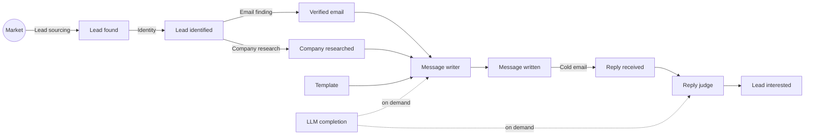

# GTM Factory: the framework

Revenue made easy. This document describes the open framework behind it: how to model a go-to-market operation as a factory, how the engine decides where every dollar goes, and how it learns from what happens. Everything here is implemented in [`packages/engine`](../packages/engine), and every number in the worked examples is checked by a test ([`docs.test.ts`](../packages/engine/test/docs.test.ts)).

## 1. The factory

Think of a car plant. Raw material comes in, stations transform it, finished cars roll out. Each station has a cost per unit and a share of units that come out good. The plant manager does not ask "which station is cheapest?" but "which line makes a car for the least money, and is a car worth more than that?"

Go-to-market works the same way. The raw material is a market, which always has a finite size. The finished product is a paying client. In between, stations turn one outcome into the next: a market becomes found leads, a found lead becomes an identified person, a person with a verified email and a researched company gets a written message, a reply becomes an interested lead, an interested lead books a meeting. Some stations are rules, some are AI, some are people. Some run in our factory, some in another one: the client's team, the client's CRM, the organic market.

The framework names these stations, measures them, and picks, at every place where several candidates compete, the one with the best value per dollar. It does so with one algorithm, everywhere, and it never stops learning.

## 2. Four objects

Only four objects carry a status of their own: **outcomes**, **pipes**, **triggers** and **scripts**. Everything else (tactics, strategies, plays, campaigns) describes them. Nothing in the engine knows the name of an outcome, a pipe or a script: add one and it competes like the others.

| Object | What it is |
|---|---|
| **Outcome** | Something reached for a subject: a lead (lead identified, lead interested), a company (company researched), an object (an ICP, a template, an LLM completion) or a trigger event. Each reached outcome is an **occurrence**. |
| **Lead track** | An ordered ladder of lead states. The CRM lifecycle track holds lead interested, meeting booked, meeting attended, paid client. The website visits track holds lead visited. Tracks are never added together. A track is data. |
| **Pipe** | Turns its input outcomes into one output outcome: a leg, from what it consumes to what it makes. A pipe may need several inputs: the message writer needs a verified email, the company research, a template, a brand context and an LLM completion. A pipe with no lead input turns the market into leads. There are pipes only: no small or big pipe. |
| **Script** | What performs a pipe. Several scripts compete on each pipe. Every script belongs to a **dynasty** of versions. |
| **Trigger** | When outcome X (or one of a list) is reached for a subject, after a delay, unless outcome Y is reached meanwhile. Or reported from outside. Each event is an occurrence. |

**A channel is a tactic, not an object.** Cold email, LinkedIn, WhatsApp, a cold call, an ad: each is a value of the list tactic "Channel" carried by scripts. Scripts of every channel compete on the same pipe; a client who wants only some channels says so in the strategy of its play ("Channel is cold email"). Two pipes differ only when what they consume or make differs.

**Identity is a pipe.** "Who is this lead?" is the outcome *lead identified*, made by competing scripts (an email and domain match, a name, company and title merge). Only the id space is common to every pipe.

**The ICP is an outcome like any other.** An ICP is a plain sentence, written by the client (a person, in the client's factory) or by an AI (in ours). Several ICPs compete as occurrences. A judge reads who fits a sentence: an AI in production, the hidden truth in the simulator.

**The market is the Start.** A market has a finite size. A script that sources leads draws people its source covers; when its reserve empties, its yield falls and budget moves elsewhere by itself.

### Inputs: produced ahead or on demand

Every input of a script is an outcome. An ICP or a template is produced ahead and consumed later. An LLM completion or a brand context is produced **on demand**: the consuming script asks the engine for its input, the engine picks the provider pipe's script and runs it, one run, one occurrence, in the ledger. A pipe called this way is a reactive pipe on the "On demand" trigger. Ahead or on demand, it is the same thing: an input outcome.

### Scripts own their business logic

A script decides which subject to pick and when to pick it again (a "days before recontact" tactic), and remembers what it needs: "no email found for this lead", "picked this person on day 12". It keeps that in its **pipe storage**: one database schema per pipe, shared by the scripts of that pipe and read by nobody else. Across pipes, data moves only through consumed occurrences. A script is handed its own pipe's storage and nothing that reaches another one: there is no lookup by pipe on what it receives.

**One run, one script.** A run performs one script. When it does not produce the outcome, the run is a run without the outcome: no other script is tried on that subject. A script may embed a fallback of its own, and it is then simply a different script.

### Dynasties

Anything an input can choose (a script, or an occurrence of an object outcome) may belong to a dynasty of versions. The input choice picks a dynasty and serves its head version. Stats pool across the versions of a dynasty. An **upgrade** is a new version of the same dynasty: it starts from the dynasty's belief. A **fork** is a new dynasty: it starts from its parent's belief. LLM models, templates and ICPs are examples of this one rule; the engine holds no line about any of them.

## 3. Two calculations

Every decision rests on two numbers that flow in opposite directions.

**Cost flows forward from Start.** One occurrence of a state costs what it took to make the previous one, plus the leg's own cost per attempt, divided by its yield:

`C(start) = 0` and `C(to) = (C(from) + c) / y`

**Value flows backward from the target.** A paid client is worth the offer's lifetime revenue. A state before it is worth what you can make of it, net of what that costs, or nothing:

`V(target) = value` and `V(s) = max(0, y x V(next) - c)`

For a sales funnel of legs 1 to n, the cost of one target outcome is

`T = c1 / (y1 y2 ... yn) + c2 / (y2 ... yn) + ... + cn / yn`

and its value per dollar is `value / T`.

### Worked example

A client sells a service with a lifetime revenue of **$2,100**, through a funnel of three legs:

| Leg | Cost per attempt | Yield |
|---|---|---|
| Start to Lead interested | $1 | 2% |
| Lead interested to Meeting booked | $2 | 40% |
| Meeting booked to Paid client | $10 | 20% |

Cost forward: one interested lead costs $1 / 0.02 = **$50**. One meeting costs ($50 + $2) / 0.4 = **$130**. One paid client costs ($130 + $10) / 0.2 = **$700**.

Read per paid client, each leg's attempts per target outcome are its **leads needed**: the closing leg needs 5 meetings, the booking leg needs 12.5 interested leads, the first leg needs 625 attempts. Value per dollar: $2,100 / $700 = **3.0**.

Value backward: a meeting is worth 0.2 x $2,100 - $10 = **$410**. An interested lead is worth 0.4 x $410 - $2 = **$162**. One attempt is worth 0.02 x $162 - $1 = **$2.24** net.

### Budget and the price of a dollar

Actions are funded in order of value per dollar until the budget runs out. With $500 to spend, an action returning $6 per dollar that can absorb $300, and one returning $3 that can absorb $1,000: the first gets $300, the second $200. One more dollar of budget is worth **$3**: the shadow price of a dollar. An action returning less than $1 per dollar is never funded.

## 4. The input choice

A **choice point** is any place where the catalogue offers several candidates: the play of a leg, the script providing an input, the occurrence of an object outcome to consume. The choice lives on the **input**, never on the provider pipe: a choice point is a pair (consuming pipe, input). The same LLM pipe plugged into the message writer and into the reply judge makes two choice points. GLM can be the best value per dollar for the writer while Gemini Pro is the best for the judge.

The engine orchestrates. To reach the end of a leg for a subject, it picks the leg's play, then for each input of the pipe it is about to run, the script providing that input (or the occurrence to consume), runs it, and goes on when the occurrence lands. Every choice is an **input choice** of the universal prioritizer.

### The universal prioritizer

One algorithm for every input choice: **Thompson sampling on value per dollar**.

1. Each option carries a belief about the share of its decisions that reach the outcome the decision exists for (the end of the campaign's leg), and a belief about its **measured** cost from the decision to that end (the cost of the option chosen, never an average over options).
2. Draw one rate and one cost from each belief.
3. Score each option: rate x value / cost.
4. Pick the highest.

An option with little data has wide beliefs: sometimes it draws high and gets tried. Exploration comes by construction: no quota, no threshold, no learning phase.

### Credit through traceability

Every occurrence carries its **traceability**: the input choices that led to it, its own included, and those carried by the occurrences it consumed. When the end of a leg lands, every input choice on its traceability is credited. An option is scored on the outcome its decision exists for, never on its own step: a template almost always lets the writer write, so its own step says nothing; the reply rate of the messages it served says everything.

### Pooling: script, input, clients sharing tactics, client

A belief is pooled across four levels, each pulled toward the one above with a strength fitted from the data (empirical Bayes): the script's level everywhere it is offered (relative to each point's average, so general knowledge travels) and its tactic group's, then this input across the fleet, then clients sharing the client's tactics, then the client. Local data wins as it grows.

Worked example, with a fleet rate of 2% counted as 200 trials of prior experience, for a client whose true rate is 3%:

| Client data | Estimate |
|---|---|
| No trials | 2.0% |
| 3 successes out of 50 | (3 + 4) / 250 = **2.8%** |
| 30 out of 1,000 | (30 + 4) / 1,200 = **2.83%** |
| 300 out of 10,000 | (300 + 4) / 10,200 = **2.98%** |

### Delays, settled failures, time

A reply can land days after the message. A decision whose attempt is still open counts for the share of outcomes already due at its age (the delay distribution's CDF). A decision whose attempt has ended without the outcome counts in full: a known failure is not pending.

Worked example: 100 decisions made 7 days ago, 70% of outcomes usually arrive within 7 days, 2 successes so far, all still open. They are worth 100 x 0.7 = 70 full trials, and the estimate is 2 / 70 = **2.86%**, not 2%.

Each day's decisions are read like for like: weighted by how that day's decisions did at the same point, all options together, so an option tried mostly while the rest of the factory was still learning is not blamed for it. Old evidence fades with a half-life (data of the world), so a world that changes is read again.

## 5. Tactics, strategies, plays

A **tactic** is a typed property: yes or no, one value from a list (country: United States, France...), or a number (revenue, headcount, days before recontact). The same tactics describe scripts and leads, judged by an AI or read from data.

A **strategy** is a set of conditions on tactics: equals, in a list, within a range. A **play** is a pipe with a strategy. A strategy states its conditions **per input** of its pipe: a campaign's play on the writer can require "Model tier is pro" at its LLM input while the reply judge's LLM input stays open. A strategy may also state who the play serves (lead tactics, end states never reached: "never write to people who asked to stop"). A campaign chooses its strategy per pipe; a pipe it leaves out plays its default strategy, which has no condition. Eligibility rules such as recontact windows are script tactics filtered by the campaign's strategy: "Days before recontact is 60 or more" at the identity pipe's lead input.

A **sales path** is a straight line of lead states from Start (or a trigger's event) to a target. A **sales funnel** is a sales path with one play per leg. Both are catalogue objects: each gets a stable id and a plain name the first time it is seen ("Paid clients from the market"; "Reply judge, AI booking, Reminders and Closing for paid clients"), keeps it, and never shares it, so it can be listed, pinned and read on its own page. A **campaign** runs a named sales funnel, with a daily budget: the funnel it runs today is its path with the play each leg picks (or the play it pinned).

A funnel is drawn as every pipe each leg runs through, in the order they run: the follow-up leg reads Follow-up due, Follow-up email, Reply received, Reply judge, Lead interested. A pipe feeding a side input (a company research, a model call) rides beside the pipe it feeds. The plays of a campaign are exactly the pipes of its line.

## 6. One split mechanism

The engine looks for a tactic that separates successes from failures, decision-tree style: a yes/no tactic splits true against false, a list tactic groups its values (sorted by rate, every cut of that order), a number tactic is cut at the deciles of its values. Each side needs at least 10 outcomes. The verdict rule:

- **Conclusion**: the exact test on the raw counts passes, corrected for the number of splits tried (Bonferroni), and the like-for-like test (Mantel-Haenszel, inside the same client and month) passes in the same direction;
- **Signal**: only the raw test passes, often a mix effect;
- **Noise**: everything else, or a leader with fewer than 5 outcomes.

A split on **leads** proposes a finer ICP: an AI script writes a new occurrence, a fork of the ICP it refines, that starts from its parent's belief and competes. A split on **scripts** proposes a strategy (conditions at an input) and its play. Main effects come first; an interaction enters only when a split proves it.

## 7. Triggers and reactive campaigns

The follow-up trigger reads: when a message is written, after 4 days, unless a reply is received meanwhile. Each event is an occurrence of "follow-up due". A reactive campaign starts from that trigger instead of Start: its first leg runs on each event, and its follow-up pipe consumes the event and the earlier message. End states (unsubscribed, not interested) are outcomes a strategy can exclude.

## 8. Other factories and reliability

Every occurrence names its producer: one of our runs, or another factory (the client's team, their CRM, the organic market) at a named access cost, zero allowed. Everything is counted; the return of our pipes values only what our runs brought in. A paid client who came in organically counts in the client's figures, never in our return.

Whoever attests an outcome is a pipe: a reply judge, a CRM import, a website tracker. **Reliability** is the third measured property of a pipe's or a script's output, beside yield and cost: its agreement with the outcome's reference pipe on the same subjects. Merged over the producers that attested it, an outcome carries a **confidence**: one minus the chance that every one of them is wrong. A client counts in an outcome's figures only where a reliable producer covers it.

## 9. Decide versus report

**To decide**, the engine reads each option's own measured cost and rate, from the decision to the end of its leg. **To report**, the ledger prices every outcome every path: its own production, plus its inputs at their own unit cost, with cycles solved. Expected and measured returns share one formula: value / T, T computed on the campaign's legs (expected: censoring-corrected leg rates and measured costs; measured: the value won and the spend of the people who entered long enough ago).

An occurrence keeps the price paid to produce it, its **standard cost**, and every consumption pays that price. When an occurrence is consumed again (a company research serving every lead of that company, a template serving thousands of messages), the books show a **reuse gain**. Everything reconciles to the cent:

`standard cost charged - reuse gain + spend of runs producing none = total run spend`

Worked example, in cents. A sourcing run spends 1,000 and finds 3 leads (334, 333 and 333 each). An email run spends 600, consumes the 3 leads and produces 1 interested lead. A second email run spends 300, consumes the first lead again and produces nothing. A setup run spends 500 (support). A run on a lead already interested spends 200 (abnormal loss). Total spend: 2,600.

Standard cost charged: 334 x 2 + 333 + 333 + 600 = **$19.34**. Reuse gain: **$3.34**. Runs producing none: 300 + 500 + 200 = **$10.00**. And $19.34 - $3.34 + $10.00 = **$26.00**, the total spend.

The email pipe's own cost for decisions: $9 over 4 inputs is **$2.25** per input. The every-path unit cost of the interested lead for reports: $9 of its own production plus 4 leads at $3.33 each, about **$22.33**.

## 10. The simulator

The engine ships with a fictional world as data ([`seed/fictional-world.json`](../seed/fictional-world.json)): four fictional clients, their market of fictional people and companies, the catalogue, and the hidden truth (yields, costs, delays, the effect of every script at every input, of every template and of every lead tactic). Day by day, under each campaign's budget, the engine makes every input choice, runs produce occurrences after their delay, the ledger fills and the engine learns. One seed gives one history, byte for byte. On the default world with its seed, every choice point with 200 picks or more ends day 60 with 80% or more of its picks on the hidden best option.

The dashboard plays it: [`apps/dashboard`](../apps/dashboard), live at https://distribute-you.github.io/gtm-factory/.
