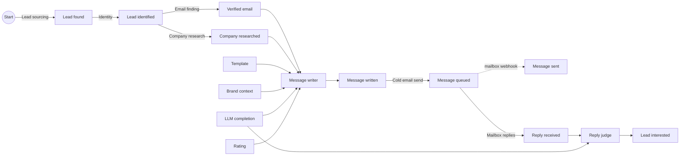

# GTM Factory: the framework

Revenue made easy. This document describes the open framework behind it: how to model a go-to-market operation as an industrial plant, with the plant's own words and its own cost accounting. Everything here is implemented in [`packages/engine`](../packages/engine), and every number in the worked examples is checked by a test ([`docs.test.ts`](../packages/engine/test/docs.test.ts)).

## 1. The factory

Think of a car plant. Orders come in, stations pull parts from the stations before them, finished cars roll out. Each station has a bill of materials, a cost per run and a share of runs that come out good. The plant manager does not ask "which station is cheapest?" but "which line makes a car for the least money, and is a car worth more than that?"

Go-to-market works the same way. The raw material is a market, which always has a finite size. The finished product is a paying client. In between, stations turn one part into the next: a market becomes found leads, a found lead becomes an identified person, a person with a verified email and a researched company gets a written message, the message is queued by our send call, the mailbox reports it sent and reads the reply, a reply becomes an interested lead, an interested lead books a meeting. Some stations are rules, some are AI, some are people. Some run in our factory, some in another one: the client's team, the client's CRM, the mailbox, the organic market.

The framework names these stations, measures them, and picks, at every place where several candidates compete, the one with the best value per dollar. It does so with one algorithm, everywhere, and it never stops learning.

## 2. The objects

Three objects carry a status of their own: **outcomes**, **pipes** and **scripts**. Everything else describes them, orders from them or records what they did. Nothing in the code knows the name of an outcome, a pipe or a script: add one and it competes like the others.

| Object | What it is |
|---|---|
| **Outcome** | A part reference: Lead interested, Message sent, Template, Rating. It says what a piece is about (its subject): a lead, a company, the brand, or the run that ordered it. |
| **Unit** | One physical piece of an outcome: Marie, interested on day 24. Every Unit lands in the ledger, names its producer and carries its traceability. In industrial cost accounting, the unit is what a cost is computed for. |
| **Lead track** | An ordered ladder of lead states. The CRM lifecycle track holds lead interested, meeting booked, meeting attended, paid client. The website visits track holds lead visited. Tracks are never added together. A track is data. |
| **Pipe** | A station: it turns its Bill of materials into one output outcome. There are pipes only: no small or big pipe. |
| **Bill of materials** | What a pipe consumes per Unit it produces. Each line is one **Material**, an outcome. The message writer's Bill of materials: 1 Verified email, 1 Company researched, 1 Template, 1 Brand context, 1 LLM completion, 1 Rating. The Material that carries the subject (the verified email) is the Unit the pipe works on. |
| **Script** | What performs a pipe. Several scripts compete on each pipe. Every script belongs to a **dynasty** of versions. |
| **Run** | A production order: one script executed, one Unit or none. |
| **Specification** | New generic object. What a consumer asks for when it pulls: a subject, conditions, a quantity (section 3). In plant words, a cahier des charges. |
| **Campaign** | Orders production: a target outcome, a daily budget (with an optional volume per period) and a start outcome (section 3). |
| **Factory** | Who performs a pipe: ours, or another factory (the client's team, the client's CRM, the mailbox, the organic market) at a named access cost, zero allowed. |

**Every API call output is an outcome.** A cold email is not one station. The writer makes a Message written; our send call makes a Message queued; the mailbox reports a Message sent and reads each Reply received. Each is an outcome with its own Units, so each can be measured, priced and consumed.

**A channel is a tactic, not an object.** Cold email, LinkedIn, WhatsApp, a cold call, an ad: each is a value of the list tactic "Channel" carried by scripts. Scripts of every channel compete on the same pipe; a client who wants only some channels says so in the strategy of its play ("Channel is cold email"). Two pipes differ only when what they consume or make differs.

**Identity is a pipe.** "Who is this lead?" is the outcome *lead identified*, made by competing scripts (an email and domain match, a name, company and title merge). Only the id space is common to every pipe.

**The ICP is an outcome like any other.** An ICP is a plain sentence, written by the client (a person, in the client's factory) or by an AI (in ours). Several ICPs compete as Units of the brand. A judge reads who fits a sentence: an AI in production, the hidden truth in the simulator.

**The market is Start.** A market has a finite size. A script that sources leads draws people its source covers; when its reserve empties, its yield falls and budget moves elsewhere by itself.

## 3. Pull and push

### The two functions of a pipe

Every pipe exposes two functions, and both open Runs.

- `pull(specification, quantity, budget)` serves Units that conform to the Specification: from the stock when some conform, else by producing them.
- `push(unit, budget)` advances that one Unit: the pipe takes it as the Unit it works on and serves itself the rest of its Bill of materials.

A **Specification** states three things, nothing more:

- the **subject**: "Paul", "the company of Paul", "Acme" (the brand), or "this run" for a Unit that answers one run's question;
- **conditions** on tactics, with the three condition types of section 6 (equals, in a list, within a range): "Brand context younger than 90 days", "Channel is cold email". The conditions a Campaign's strategy states at a Material enter here;
- a **quantity**.

A push carries no Specification: the pushed Unit is the Material.

### The Campaign orders production

A Campaign is a target outcome, a daily budget (with an optional volume per period) and a start outcome.

- **Started from Start** (the market), it is **proactive**. At each tick the Campaign calls pull on its target pipe. A pipe that lacks a Unit pulls from the pipe before it, down to Start if need be. The most advanced Units are served first: open work nearest the target, then Units waiting in the stock at a lead state of the line. Only then does the Campaign take new subjects from the market, with the budget left and within its volume. Upstream produces only what downstream asked for: a new lead is made only as one order of its Campaign.
- **Started from any other outcome**, it is **reactive**. When a Unit of its start outcome lands for its brand, the Campaign pushes it into its first pipe, as far as its budget allows. What the budget cannot pay for waits for the next tick.

A Unit advances one pipe per tick: every run takes time, at least one tick, and a reply takes days. All campaigns and all their pipes run at each tick, each campaign on its own budget, spread over the day's ticks. A capacity several campaigns share (a mailbox, a vendor's limit) is a budget like any other: it goes to the campaigns in order of value per dollar (section 4).

### Worked example: a pull

Acme orders Meetings booked: a campaign started from Start, with a daily budget of $10 and 20 new subjects a day. Each pipe has one script and, to read the story, every yield is 1. Follow Paul, the first lead.

- Tick 0. Meeting booked is pulled; there is no Lead interested in the stock, so the booking pulls from the reply judge, the judge from the mailbox, down to Start. Lead sourcing runs. Paul's Lead found lands at tick **1**.
- Tick 1: identity runs on Paul; his Lead identified lands at tick **2**. Tick 2: email finding; his Verified email lands at tick **3**.
- Tick 3. The message writer has the Unit it works on and serves itself the rest of its Bill of materials. Its Template and today's Rating are in the stock. It pulls a Company researched with the Specification "the company of Paul", and a Brand context with "Acme, younger than 90 days". Neither conforms yet, so each is ordered from one producer, and an LLM completion is ordered for the run. Acme spends **$2.44** that tick, for every lead at every stage.
- Tick 4: the writer runs. One Brand context was made for **157** messages over twelve days: every writer after the first is served from the stock. **20** Company researched Units served **157** messages: a colleague's research conforms.
- Ticks 5 to 9: our send call, the mailbox's reply, the judge (its LLM completion ordered at tick 7). Paul's Lead interested lands in the stock, the booking leg pulls it at once, and his Meeting booked lands at tick **10**.

### Worked example: a push

A follow-up campaign starts from Message sent and targets Lead interested. When the mailbox's webhook reports a Message sent, the Unit lands in the stock and the Campaign pushes it into its first pipe, the follow-up. The follow-up's script reads its tactic "Days since last message" (4): it keeps a reference to the Unit in its pipe storage and runs when 4 days have passed. Nothing cancels it. A subject who reached the target meanwhile is done: the target is reached. Who is never served (people who unsubscribed, people not interested) is an end state the strategy of the play excludes.

### Webhooks

A **webhook** is the script of a pipe with no internal Material, whose producer is another factory: the prospect, the client's CRM, the mailbox. It runs when the webhook is called, not at the tick. Its Units land in the ledger, available to every campaign, and their arrival pushes the reactive campaigns that start from that outcome. Downstream pipes plug into the outcome, never into a webhook. The call names the Unit it reports on, so a Message sent carries the traceability of the message queued. The pipe that attests a fact is incoming inspection; how far it can be trusted is its reliability (section 9).

## 4. The ledger is the common stock

Every Unit, from every producer, lands in one stock: our pipes, the client's team, the client's CRM, the organic market. Several producers can feed one outcome: an interested lead found by our reply judge and one who came by herself sit side by side, and the booking leg serves itself from both.

A consuming pipe serves itself from the stock, filtered by its Specification. If no Unit conforms, it pulls from ONE producer pipe, chosen by the Supplier rating (section 5); it may also order a new piece from a specific producer directly, as the writer does with an LLM completion.

A pipe's storage holds only its script's notes ("no email found for this lead", "picked this person on day 12") and references to ledger Units, never copies. It is shared by the scripts of that pipe and read by nobody else.

**Reuse.** A Unit never wears out: information is copied, not consumed, like a mould rather than raw material. Several campaigns may consume the same Unit; the books show it as a reuse gain (section 10). Limiting action on the same person is the script's tactic "Days before recontact", filtered by the strategy, never a parameter of the outcome or of the campaign. "Consumed" means the Unit appears in the traceability of what it served.

**One run, one script.** A run performs one script. When it does not produce the outcome, the run is a run without the outcome: no other script is tried on that subject. A script may embed a fallback of its own, and it is then simply a different script.

### Dynasties

Anything a Material can choose (a script, or a Unit of the brand) may belong to a dynasty of versions. The choice picks a dynasty and serves its head version. Stats pool across the versions of a dynasty. An **upgrade** is a new version of the same dynasty: it starts from the dynasty's belief. A **fork** is a new dynasty: it starts from its parent's belief. LLM models, templates and ICPs are examples of this one rule; the code holds no line about any of them.

## 5. The choice and the Supplier rating

A **choice point** is any place where several candidates compete: the play of a leg, the producer of a Material, the Unit of the brand to consume. The choice lives on the **Material**, never on the producer pipe: a choice point is a pair (consuming pipe, Material). The same LLM pipe in the message writer's Bill of materials and in the reply judge's makes two choice points. GLM can be the best value per dollar for the writer while Gemini Pro is the best for the judge.

### Stats are an outcome: the Supplier rating

A pipe cannot judge its options from its own data: a template's replies land later, in another pipe. The **Supplier rating** pipe, an auxiliary cost center in cost-accounting terms, reads the ledger and the traceability and produces, at each tick, a **Rating** Unit for each brand: per option at each choice point, its beliefs about value per dollar. Every choosing pipe takes the Rating as a Material and chooses its scripts and its Material options itself. The Rating's cost is allocated, through the ledger, to the pipes that consume it.

The Rating's script is one rule for every choice: **Thompson sampling on value per dollar**.

1. Each option carries a belief about the share of its decisions that reach the outcome the decision exists for (the end of the campaign's leg), and a belief about its **measured** cost from the decision to that end (the cost of the option chosen, never an average over options).
2. Draw one rate and one cost from each belief.
3. Score each option: rate x value / cost.
4. Pick the highest.

An option with little data has wide beliefs: sometimes it draws high and gets tried. Exploration comes by construction: no quota, no threshold, no learning phase.

### Credit through traceability

Every Unit carries its **traceability**: the choices that led to it, its own included, and those carried by the Units it consumed. When the end of a leg lands, every choice on its traceability is credited. An option is scored on the outcome its decision exists for, never on its own step: a template almost always lets the writer write, so its own step says nothing; the reply rate of the messages it served says everything.

### Pooling: script, Material, clients sharing tactics, client

A belief is pooled across four levels, each pulled toward the one above with a strength fitted from the data (empirical Bayes): the script's level everywhere it is offered (relative to each point's average, so general knowledge travels) and its tactic group's, then this Material across the fleet, then clients sharing the client's tactics, then the client. Local data wins as it grows.

Worked example, with a fleet rate of 2% counted as 200 trials of prior experience, for a client whose true rate is 3%:

| Client data | Estimate |
|---|---|
| No trials | 2.0% |
| 3 successes out of 50 | (3 + 4) / 250 = **2.8%** |
| 30 out of 1,000 | (30 + 4) / 1,200 = **2.83%** |
| 300 out of 10,000 | (300 + 4) / 10,200 = **2.98%** |

### Delays, settled failures, time

A reply can land days after the message, and every pipe still to run takes at least a tick. A decision whose attempt is still open counts for the share of outcomes already due at its age (the delay distribution's CDF); the ticks the remaining pipes must take are certain, so nothing is due before them. A decision whose attempt has ended without the outcome counts in full: a known failure is not pending.

Worked example: 100 decisions made 7 days ago, 70% of outcomes usually arrive within 7 days, 2 successes so far, all still open. They are worth 100 x 0.7 = 70 full trials, and the estimate is 2 / 70 = **2.86%**, not 2%.

Each day's decisions are read like for like: weighted by how that day's decisions did at the same point, all options together, so an option tried mostly while the rest of the factory was still learning is not blamed for it. Old evidence fades with a half-life (data of the world), so a world that changes is read again.

## 6. Tactics, strategies, plays

A **tactic** is a typed property: yes or no, one value from a list (country: United States, France...), or a number (revenue, headcount, days before recontact, days since last message, a Unit's age). The same tactics describe scripts, leads and Units, judged by an AI or read from data.

A **strategy** is a set of conditions on tactics: equals, in a list, within a range. A **play** is a pipe with a strategy. A strategy states its conditions **per Material** of its pipe, and those conditions enter the Specification of that Material: they filter both the Units served from the stock and the producer scripts ordered from. A campaign's play on the writer can require "Model tier is pro" at its LLM completion while the reply judge's stays open, or "Brand context younger than 30 days" at its Brand context. A strategy may also state who the play serves (lead tactics, end states never reached: "never write to people who asked to stop"). A campaign chooses its strategy per pipe; a pipe it leaves out plays its default strategy, which has no condition. Eligibility rules such as recontact windows are script tactics filtered by the campaign's strategy: "Days before recontact is 60 or more" at the identity pipe's Lead found.

A **sales path** is a straight line of lead states from a start outcome (Start, or any outcome) to a target. A **sales funnel** is a sales path with one play per leg. Both are catalogue objects: each gets a stable id and a plain name the first time it is seen ("Paid clients from the market"; "Reply judge, AI booking, Reminders and Closing for paid clients"), keeps it, and never shares it, so it can be listed, pinned and read on its own page. A campaign runs a named sales funnel: the funnel it runs today is its path with the play each leg picks (or the play it pinned).

A funnel is drawn as every pipe each leg runs through, in the order they run: the follow-up leg reads Message sent, Follow-up, Mailbox follow-up replies, Reply judge, Lead interested. A pipe feeding a side Material (a company research, a model call) rides beside the pipe it feeds. The plays of a campaign are exactly the pipes of its line.

## 7. One split mechanism

The split mechanism looks for a tactic that separates successes from failures, decision-tree style: a yes/no tactic splits true against false, a list tactic groups its values (sorted by rate, every cut of that order), a number tactic is cut at the deciles of its values. Each side needs at least 10 outcomes. The verdict rule:

- **Conclusion**: the exact test on the raw counts passes, corrected for the number of splits tried (Bonferroni), and the like-for-like test (Mantel-Haenszel, inside the same client and month) passes in the same direction;
- **Signal**: only the raw test passes, often a mix effect;
- **Noise**: everything else, or a leader with fewer than 5 outcomes.

A split on **leads** proposes a finer ICP: an AI script writes a new Unit, a fork of the ICP it refines, that starts from its parent's belief and competes. A split on **scripts** proposes a strategy (conditions at a Material) and its play. Main effects come first; an interaction enters only when a split proves it.

## 8. The two calculations

Every decision rests on two numbers that flow in opposite directions.

**Cost flows forward from Start.** One Unit of a state costs what it took to make the previous one, plus the leg's own cost per attempt, divided by its yield:

`C(start) = 0` and `C(to) = (C(from) + c) / y`

**Value flows backward from the target.** A paid client is worth the offer's lifetime revenue. A state before it is worth what you can make of it, net of what that costs, or nothing:

`V(target) = value` and `V(s) = max(0, y x V(next) - c)`

For a sales funnel of legs 1 to n, the cost of one target Unit is

`T = c1 / (y1 y2 ... yn) + c2 / (y2 ... yn) + ... + cn / yn`

and its value per dollar is `value / T`.

### Worked example

A client sells a service with a lifetime revenue of **$2,100**, through a funnel of three legs:

| Leg | Cost per attempt | Yield |
|---|---|---|
| Start to Lead interested | $1 | 2% |
| Lead interested to Meeting booked | $2 | 40% |
| Meeting booked to Paid client | $10 | 20% |

Cost forward: one interested lead costs $1 / 0.02 = **$50**. One meeting costs ($50 + $2) / 0.4 = **$130**. One paid client costs ($130 + $10) / 0.2 = **$700**.

Read per paid client, each leg's attempts per target Unit are its **leads needed**: the closing leg needs 5 meetings, the booking leg needs 12.5 interested leads, the first leg needs 625 attempts. Value per dollar: $2,100 / $700 = **3.0**.

Value backward: a meeting is worth 0.2 x $2,100 - $10 = **$410**. An interested lead is worth 0.4 x $410 - $2 = **$162**. One attempt is worth 0.02 x $162 - $1 = **$2.24** net.

### Budget and the price of a dollar

A budget, and any capacity several campaigns share, is funded in order of value per dollar until it runs out. With $500 to spend, an action returning $6 per dollar that can absorb $300, and one returning $3 that can absorb $1,000: the first gets $300, the second $200. One more dollar of budget is worth **$3**: the price of the marginal dollar. An action returning less than $1 per dollar is never funded.

## 9. Other factories and reliability

Every Unit names its producer: one of our runs, or another factory (the client's team, their CRM, the mailbox, the organic market) at a named access cost, zero allowed. Everything is counted; the return of our pipes values only what our runs brought in. A paid client who came in organically counts in the client's figures, never in our return.

Whoever attests an outcome is a pipe: a reply judge, a CRM webhook, a website tracker. **Reliability** is the third measured property of a pipe's or a script's output, beside yield and cost: its agreement with the outcome's reference pipe on the same subjects. Merged over the producers that attested it, an outcome carries a **confidence**: one minus the chance that every one of them is wrong. A client counts in an outcome's figures only where a reliable producer covers it.

## 10. Decide versus report

**To decide**, the Rating reads each option's own measured cost and rate, from the decision to the end of its leg. **To report**, the ledger prices every outcome every path: its own production, plus its Materials at their own unit cost, with cycles solved. Expected and measured returns share one formula: value / T, T computed on the campaign's legs (expected: censoring-corrected leg rates and measured costs; measured: the value won and the spend of the people who entered long enough ago).

A Unit keeps the price paid to produce it, its **standard cost**, and every consumption pays that price. When a Unit is consumed again (a company research serving every lead of that company, a template serving thousands of messages, a Rating serving every choice of its tick), the books show a **reuse gain**. Everything reconciles to the cent:

`standard cost charged - reuse gain + spend of runs producing none = total run spend`

Worked example, in cents. A sourcing run spends 1,000 and finds 3 leads (334, 333 and 333 each). An email run spends 600, consumes the 3 leads and produces 1 interested lead. A second email run spends 300, consumes the first lead again and produces nothing. A setup run spends 500 (support). A run on a lead already interested spends 200 (abnormal loss). Total spend: 2,600.

Standard cost charged: 334 x 2 + 333 + 333 + 600 = **$19.34**. Reuse gain: **$3.34**. Runs producing none: 300 + 500 + 200 = **$10.00**. And $19.34 - $3.34 + $10.00 = **$26.00**, the total spend.

The email pipe's own cost for decisions: $9 over 4 Units consumed is **$2.25** per Unit. The every-path unit cost of the interested lead for reports: $9 of its own production plus 4 leads at $3.33 each, about **$22.33**.

## 11. The simulator

The framework ships with a fictional world as data ([`seed/fictional-world.json`](../seed/fictional-world.json)): four fictional clients, their market of fictional people and companies, the catalogue, and the hidden truth (yields, costs, delays, the effect of every script at every Material, of every template and of every lead tactic, and when each other factory calls its webhooks). The world ticks 24 times a day. At each tick the campaigns pull and push, runs land their Units after their delay, the ledger fills and the Supplier rating learns. One seed gives one history, byte for byte. On the default world with its seed, every choice point with 200 picks or more ends day 60 with 80% or more of its picks on the hidden best option.

A second scenario, **distribute.you catalogue** ([`seed/distribute-world.json`](../seed/distribute-world.json)), plays distribute.you's whole public GTM catalogue: every channel, leg and step it serves ([`seed/distribute-catalogue.json`](../seed/distribute-catalogue.json), its identity-free reads stripped of every production figure and price), translated by [`packages/scenarios`](../packages/scenarios) into this model. A pipe is a leg; each of the 53 channels is a value of the "Channel" tactic its generated scripts carry. A leg that reacts to an outcome consumes it, a delay is its scripts' "Days since last message", and a fact another system reports is an outcome its webhook makes. Its clients and numbers are fictional.

The dashboard plays it: [`apps/dashboard`](../apps/dashboard), live at https://distribute-you.github.io/gtm-factory/. Built with its api data source, the same dashboard reads a running factory through the factory API ([`docs/api.md`](api.md)).
