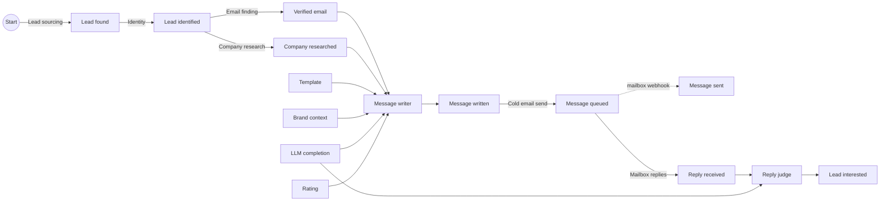

# GTM Factory v5: the framework

Revenue made easy. This document describes the open framework behind it: how to model a go-to-market operation as an industrial plant, with the plant's own words and its own cost accounting. Everything here is implemented in [`packages/engine`](../packages/engine), and every number in the worked examples is checked by a test ([`docs.test.ts`](../packages/engine/test/docs.test.ts)).

## 1. The factory

Think of a car plant. An order comes in for a car. The plant explodes the car's bill of materials: an engine, a body, four wheels; each part has its own bill of materials, down to raw steel. Each part comes from the stock when one is there, else it is ordered from the best supplier for it. The full production cost of the car is rolled up along that tree. The plant manager does not ask "which station is cheapest?" but "which tree makes a car for the least money, and is a car worth more than that?"

Go-to-market works the same way. The raw material is a market, which always has a finite size. The finished product is a paying client. In between, legs turn one outcome into the next: a market becomes found leads, a found lead becomes an identified person, a person with a verified email and a researched company gets a written message, the message is queued by our send call, the mailbox reports it sent and reads the reply, a reply becomes an interested lead, an interested lead books a meeting. Some legs are performed by rules, some by AI, some by people. Some run in our factory, some in another one: the client's team, the client's CRM, the mailbox, the organic market.

The framework names these legs, measures them, and picks, at every place where several candidates compete, the one with the best value per dollar. It does so with one algorithm, everywhere, and it never stops learning.

## 2. The objects

Three objects carry a status of their own: **outcomes**, **legs** and **scripts**. Everything else describes them, orders from them or records what they did. Nothing in the code knows the name of an outcome, a leg or a script: add one and it competes like the others.

| Object | What it is |
|---|---|
| **Outcome** | A part reference: Lead interested, Message sent, Template, Rating. It says what a piece is about (its subject): a lead, a company, the brand, or the run that ordered it. |
| **Unit** | One physical piece of an outcome: Marie, interested on day 24. Every Unit lands in the ledger, names its producer and carries its traceability. In industrial cost accounting, the unit is what a cost is computed for. |
| **Lead track** | An ordered ladder of lead states. The CRM lifecycle track holds lead interested, meeting booked, meeting attended, paid client. The website visits track holds lead visited. Tracks are never added together. A track is data. |
| **Leg** | Goes from one outcome to another: it makes one output outcome, and competing scripts in dynasties perform it. A channel is not a leg: it is a tactic of the scripts. |
| **Script** | What performs a leg. Several scripts compete on each leg. Every script belongs to a **dynasty** of versions, and declares its own Bill of materials. |
| **Bill of materials** | What one script consumes per Unit it produces, as data. Each line is one **Material**: an outcome, and the conditions of the Specification the script builds from its own subject. Two scripts of one leg may need different Materials: a writer may research the company first or not; in the distribute.you catalogue, the cold email script on a leg takes a Template while the cold call script on the same leg does not. The Material that carries the subject (the verified email) is the Unit the script works on. |
| **Run** | A production order: one script executed, one Unit or none. |
| **Specification** | New generic object. What a consumer asks for when it pulls an outcome: a subject, conditions, a quantity (section 3). In plant words, a purchase order. |
| **Campaign** | Orders production: a Target, a budget (a daily budget, with an optional volume per period), a start and a strategy (section 3). |
| **Factory** | Who performs a leg: ours, or another factory (the client's team, the client's CRM, the mailbox, the organic market) at a named access cost, zero allowed. |

**Every API call output is an outcome.** A cold email is not one leg. The writer makes a Message written; our send call makes a Message queued; the mailbox reports a Message sent and reads each Reply received. Each is an outcome with its own Units, so each can be measured, priced and consumed.

**A channel is a tactic, not an object.** Cold email, LinkedIn, WhatsApp, a cold call, an ad: each is a value of the list tactic "Channel" carried by scripts. Scripts of every channel compete on the same leg; a client who wants only some channels says so in the strategy of its campaign ("Channel is cold email"). Two legs differ only when what they go from or what they make differs.

**Identity is a leg.** "Who is this lead?" is the outcome *lead identified*, made by competing scripts (an email and domain match, a name, company and title merge). Only the id space is common to every leg.

**The ICP is an outcome like any other.** An ICP is a plain sentence, written by the client (a person, in the client's factory) or by an AI (in ours). Several ICPs compete as Units of the brand. A judge reads who fits a sentence: an AI in production, the hidden truth in the simulator.

**The market is Start.** A market has a finite size. A script that sources leads draws people its source covers; when its reserve empties, its yield falls and budget moves elsewhere by itself.

## 3. Pull, push and the production tree

### The Campaign fixes a Target, never a line

A Campaign fixes only its **Target**, its budget (a daily budget, with an optional volume per period), its start and its **strategy** (conditions on tactics, such as "Channel is cold email", that every script it runs meets wherever the script carries the tactic). It never fixes a line of legs. Its **production tree** is rebuilt at every tick from performance.

- **Pull** (proactive, started from Start, the market): start from the Target and go down. Each needed Material is taken from the ledger's stock, else ordered from the best producer, recursively, down to Start.
- **Push** (reactive, started from any other outcome): start from the Unit that landed (a reply received) and go up. At each lead state, the tree gives the next one toward the Target that is worth the most; the leg that makes it consumes the pushed Unit, and its other Materials are pulled.

Both read the same tree. From each lead state, the next one is the one worth the most, value flowing backward from the Target (section 8): `V = y x V(next) - c`, with each step's yield drawn from its belief when several steps compete, so a step with little data gets tried. A lead state with one way up is not drawn. Old evidence fades with the world's half-life, so when a way up stops working, the tree moves.

In plant words, this is the explosion of the bill of materials: the Target is the car, the tree is every part and every supplier the plant uses for it today, and its full production cost is rolled up along the tree.

**The sales path and the sales funnel are views.** The sales path is the straight line of lead states the tree actually went through ("Meetings booked from the market"); the sales funnel is that path with the leg that made each lead state ("Reply judge to meetings booked"). Each gets a short name the first time it is seen and keeps it, so it can be pinned and talked about. Neither controls anything.

### The contract of a leg

A script never calls anything itself. It **declares** its Bill of materials as data: per Material, the outcome and a Specification built from its own subject ("Brand context, subject the organisation of my lead, younger than 90 days"). It receives the Materials, its leg storage and the metered vendor client, and returns one Unit or none.

The **leg** orchestrates, with the same generic code for every leg, through two functions:

- `pull(specification, quantity, budget)` serves Units that conform to the Specification: from the stock when some conform, else by producing them.
- `push(unit, budget)` advances that one Unit: the leg takes it as the Unit it works on and serves itself the rest of the Bill of materials.

Producing one Unit is always the same four moves:

1. Pick the script: the Supplier rating's best candidate (section 5), filtered by the strategy.
2. For each Material of that script's Bill of materials, look up the ledger with its Specification.
3. If none conforms, pull the **outcome**: the best producer is picked then, and receives the Specification.
4. Run the script once all its Materials are there.

A **Specification** addresses the outcome, never a producer. It states three things, nothing more:

- the **subject**: "Paul", "the company of Paul", "Acme" (the brand), or "this run" for a Unit that answers one run's question;
- **conditions** on tactics, with the three condition types of section 6 (equals, in a list, within a range): "younger than 90 days", "Model tier is pro". The conditions the script declares and those the strategy states at that Material enter here;
- a **quantity**.

The consumer does not need to know which leg or script will be picked: a purchase order names the part and its characteristics, not the machine. A push carries no Specification: the pushed Unit is the Material.

A Material that takes time (a reply takes days) leaves the subject waiting in the stock; the next tick retries. A Unit advances one leg per tick: every run takes time, at least one tick. All campaigns run at each tick, each on its own budget, spread over the day's ticks. A capacity several campaigns share (a mailbox, a vendor's limit) is a budget like any other: it goes to the campaigns in order of value per dollar (section 4). A pull serves the most advanced Units first: open work nearest the Target, then Units waiting in the stock at a lead state of the tree. Only then does the Campaign take new subjects from the market, with the budget left and within its volume. Upstream produces only what downstream asked for.

### Worked example: a pull

Acme's campaign has the Target Meeting booked, starts from Start, with a daily budget of $10 and 20 new subjects a day. Each leg has one script and, to read the story, every yield is 1. Follow Paul, the first lead.

- Tick 0. Meeting booked is pulled. The tree goes down: the booking leg needs a Lead interested, none is in the stock, so the reply judge is pulled, the judge pulls the mailbox's reply, down to Start. Lead sourcing runs. Paul's Lead found lands at tick **1**.
- Tick 1: identity runs on Paul; his Lead identified lands at tick **2**. Tick 2: email finding; his Verified email lands at tick **3**.
- Tick 3. The message writer's script holds the Unit it works on and serves itself the rest of its Bill of materials. Its Template and today's Rating are in the stock. It pulls a Company researched with the Specification "the company of Paul", and a Brand context with "Acme, younger than 90 days". Neither conforms yet, so each outcome is ordered from its best producer, and an LLM completion is ordered for the run. Acme spends **$2.44** that tick, for every lead at every stage.
- Tick 4: the writer runs. One Brand context was made for **157** messages over twelve days: every writer after the first is served from the stock. **20** Company researched Units served **157** messages: a colleague's research conforms.
- Ticks 5 to 9: our send call, the mailbox's reply, the judge (its LLM completion ordered at tick 7). Paul's Lead interested lands in the stock, the booking leg pulls it at once, and his Meeting booked lands at tick **10**.

### Worked example: a push

A second Acme campaign has the Target Meeting booked and starts from Reply received: it is reactive. Another campaign of Acme writes and sends; this one pushes every reply up. Follow Lea, the first reply.

- Tick **7**: Lea's Reply received lands. The tree gives the next lead state toward the Target, Lead interested; the reply judge consumes the reply and pulls the rest of its Bill of materials (an LLM completion ordered for the run, today's Rating).
- Her Lead interested lands at tick **9**. The Unit is pushed on: the booking leg consumes it, and her Meeting booked lands at tick **10**.
- The push campaign spent **$0.17** on Lea: the judge and its model call, then the booking.

### Webhooks

A **webhook** is the script of a leg with no internal Material, whose producer is another factory: the prospect, the client's CRM, the mailbox. It runs when the webhook is called, not at the tick. Its Units land in the ledger, available to every campaign, and their arrival pushes the reactive campaigns that start from that outcome. Downstream legs plug into the outcome, never into a webhook. The call names the Unit it reports on, so a Message sent carries the traceability of the message queued. The leg that attests a fact is incoming inspection; how far it can be trusted is its reliability (section 9).

A follow-up campaign starts from Message sent and targets Lead interested. When the mailbox's webhook reports a Message sent, the Unit lands in the stock and the Campaign pushes it up its tree, into the follow-up. The follow-up's script reads its tactic "Days since last message" (4): it keeps a reference to the Unit in its leg storage and runs when 4 days have passed. A subject who reached the Target meanwhile is done. Who is never served (people who unsubscribed, people not interested) is an end state the strategy excludes.

## 4. The ledger is the common stock

Every Unit, from every producer, lands in one stock: our legs, the client's team, the client's CRM, the organic market. Several producers can feed one outcome: an interested lead found by our reply judge and one who came by herself sit side by side, and the booking leg serves itself from both.

A script's Material is served from the stock, filtered by its Specification. If no Unit conforms, the outcome is pulled from ONE producer, chosen by the Supplier rating (section 5).

A leg's storage holds only its scripts' notes ("no email found for this lead", "picked this person on day 12") and references to ledger Units, never copies. It is shared by the scripts of that leg and read by nobody else.

**Reuse.** A Unit never wears out: information is copied, not consumed, like a mould rather than raw material. Several campaigns may consume the same Unit; the books show it as a reuse gain (section 10). Limiting action on the same person is the script's tactic "Days before recontact", filtered by the strategy, never a parameter of the outcome or of the campaign. "Consumed" means the Unit appears in the traceability of what it served.

**One run, one script.** A run performs one script. When it does not produce the outcome, the run is a run without the outcome: no other script is tried on that subject. A script may embed a fallback of its own, and it is then simply a different script.

### Dynasties

Anything a Material can choose (a script, or a Unit of the brand) may belong to a dynasty of versions. The choice picks a dynasty and serves its head version. Stats pool across the versions of a dynasty. An **upgrade** is a new version of the same dynasty: it starts from the dynasty's belief. A **fork** is a new dynasty: it starts from its parent's belief. LLM models, templates and ICPs are examples of this one rule; the code holds no line about any of them.

## 5. The choice and the Supplier rating

A **choice point** is any place where several candidates compete: the leg that makes a lead state, the producer of a Material, the Unit of the brand to consume. The choice lives on the **Material**, never on the producer: a choice point is a pair (consuming leg, Material). The same LLM leg in the message writer's Bill of materials and in the reply judge's makes two choice points. GLM can be the best value per dollar for the writer while Gemini Pro is the best for the judge.

### Stats are an outcome: the Supplier rating

A leg cannot judge its candidates from its own data: a template's replies land later, in another leg. The **Supplier rating** leg, an auxiliary cost center in cost-accounting terms, reads the ledger and the traceability and produces, at each tick, a **Rating** Unit for each brand: per candidate at each choice point, its beliefs about value per dollar. Every choosing script takes the Rating as a Material. The Rating's cost is allocated, through the ledger, to the legs that consume it.

The Rating's script is one rule for every choice: **Thompson sampling on value per dollar**.

1. Each candidate carries a belief about the share of its decisions that reach the outcome the decision exists for (the next lead state of the tree), and a belief about its **measured** cost from the decision to that outcome (the cost of the candidate chosen, never an average over candidates).
2. Draw one rate and one cost from each belief.
3. Score each candidate: rate x value / cost.
4. Pick the highest.

A candidate with little data has wide beliefs: sometimes it draws high and gets tried. Exploration comes by construction: no quota, no threshold, no learning phase.

### Credit through traceability

Every Unit carries its **traceability**: the choices that led to it, its own included, and those carried by the Units it consumed. When the next lead state lands, every choice on its traceability is credited. A candidate is scored on the outcome its decision exists for, never on its own leg: a template almost always lets the writer write, so its own leg says nothing; the reply rate of the messages it served says everything.

### Pooling: script, Material, clients sharing tactics, client

A belief is pooled across four levels, each pulled toward the one above with a strength fitted from the data (empirical Bayes): the script's level everywhere it is offered (relative to each point's average, so general knowledge travels) and its tactic group's, then this Material across the fleet, then clients sharing the client's tactics, then the client. Local data wins as it grows.

Worked example, with a fleet rate of 2% counted as 200 trials of prior experience, for a client whose true rate is 3%:

| Client data | Estimate |
|---|---|
| No trials | 2.0% |
| 3 successes out of 50 | (3 + 4) / 250 = **2.8%** |
| 30 out of 1,000 | (30 + 4) / 1,200 = **2.83%** |
| 300 out of 10,000 | (300 + 4) / 10,200 = **2.98%** |

### Delays, settled failures, time

A reply can land days after the message, and every leg still to run takes at least a tick. A decision whose attempt is still open counts for the share of outcomes already due at its age (the delay distribution's CDF); the ticks the remaining legs must take are certain, so nothing is due before them. A decision whose attempt has ended without the outcome counts in full: a known failure is not pending.

Worked example: 100 decisions made 7 days ago, 70% of outcomes usually arrive within 7 days, 2 successes so far, all still open. They are worth 100 x 0.7 = 70 full trials, and the estimate is 2 / 70 = **2.86%**, not 2%.

Each day's decisions are read like for like: weighted by how that day's decisions did at the same point, all candidates together, so a candidate tried mostly while the rest of the factory was still learning is not blamed for it. Old evidence fades with a half-life (data of the world), so a world that changes is read again.

## 6. Tactics and strategies

A **tactic** is a typed property: yes or no, one value from a list (country: United States, France...), or a number (revenue, headcount, days before recontact, days since last message, a Unit's age). The same tactics describe scripts, leads and Units, judged by an AI or read from data.

A **strategy** is a set of conditions on tactics: equals, in a list, within a range. A Campaign's strategy holds for every script it runs, wherever the script carries the tactic: "Channel is cold email" rules out the LinkedIn scripts and leaves identity alone. A **play** is a leg with a strategy of its own, stated **per Material** of that leg: its conditions enter the Specification of that Material, so they filter both the Units served from the stock and the producer scripts ordered from. A campaign's play on the writer can require "Model tier is pro" at its LLM completion while the reply judge's stays open, or "Brand context younger than 30 days" at its Brand context. A strategy may also state who the play serves (lead tactics, end states never reached: "never write to people who asked to stop"). A leg the campaign leaves out plays its default strategy, which has no condition. Eligibility rules such as recontact windows are script tactics filtered by the strategy: "Days before recontact is 60 or more" at the identity leg's Lead found.

## 7. One split mechanism

The split mechanism looks for a tactic that separates successes from failures, decision-tree style: a yes/no tactic splits true against false, a list tactic groups its values (sorted by rate, every cut of that order), a number tactic is cut at the deciles of its values. Each side needs at least 10 outcomes. The verdict rule:

- **Conclusion**: the exact test on the raw counts passes, corrected for the number of splits tried (Bonferroni), and the like-for-like test (Mantel-Haenszel, inside the same client and month) passes in the same direction;
- **Signal**: only the raw test passes, often a mix effect;
- **Noise**: everything else, or a leader with fewer than 5 outcomes.

A split on **leads** proposes a finer ICP: an AI script writes a new Unit, a fork of the ICP it refines, that starts from its parent's belief and competes. A split on **scripts** proposes a strategy (conditions at a Material) and its play. Main effects come first; an interaction enters only when a split proves it.

## 8. The two calculations

Every decision rests on two numbers that flow in opposite directions, step by step of the sales path.

**Cost flows forward from Start.** One Unit of a state costs what it took to make the previous one, plus the step's own cost per attempt, divided by its yield:

`C(start) = 0` and `C(to) = (C(from) + c) / y`

**Value flows backward from the Target.** A paid client is worth the offer's lifetime revenue. A state before it is worth what you can make of it, net of what that costs, or nothing:

`V(target) = value` and `V(s) = max(0, y x V(next) - c)`

For a sales path of steps 1 to n, the cost of one Target Unit is

`T = c1 / (y1 y2 ... yn) + c2 / (y2 ... yn) + ... + cn / yn`

and its value per dollar is `value / T`.

### Worked example

A client sells a service with a lifetime revenue of **$2,100**, through a sales path of three steps:

| Step | Cost per attempt | Yield |
|---|---|---|
| Start to Lead interested | $1 | 2% |
| Lead interested to Meeting booked | $2 | 40% |
| Meeting booked to Paid client | $10 | 20% |

Cost forward, which a campaign page shows as each step's **cost from Start**: one interested lead costs $1 / 0.02 = **$50**. One meeting costs ($50 + $2) / 0.4 = **$130**. One paid client costs ($130 + $10) / 0.2 = **$700**. The **cost of this step per outcome** leaves out the steps before it: $2 / 0.4 = $5 per meeting.

Read per paid client, each step's attempts per Target Unit are its **attempts per Paid client**: the closing step makes 5 attempts on meetings, the booking step 12.5 on interested leads, the first step 625 from the market. Value per dollar: $2,100 / $700 = **3.0**.

Value backward: a meeting is worth 0.2 x $2,100 - $10 = **$410**. An interested lead is worth 0.4 x $410 - $2 = **$162**. One attempt is worth 0.02 x $162 - $1 = **$2.24** net.

### Budget and the price of a dollar

A budget, and any capacity several campaigns share, is funded in order of value per dollar until it runs out. With $500 to spend, an action returning $6 per dollar that can absorb $300, and one returning $3 that can absorb $1,000: the first gets $300, the second $200. One more dollar of budget is worth **$3**: the price of the marginal dollar. An action returning less than $1 per dollar is never funded.

## 9. Other factories and reliability

Every Unit names its producer: one of our runs, or another factory (the client's team, their CRM, the mailbox, the organic market) at a named access cost, zero allowed. Everything is counted; the return of our legs values only what our runs brought in. A paid client who came in organically counts in the client's figures, never in our return.

Whoever attests an outcome is a leg: a reply judge, a CRM webhook, a website tracker. **Reliability** is the third measured property of a leg's or a script's output, beside yield and cost: its agreement with the outcome's reference leg on the same subjects. Merged over the producers that attested it, an outcome carries a **confidence**: one minus the chance that every one of them is wrong. A client counts in an outcome's figures only where a reliable producer covers it.

## 10. Decide versus report

**To decide**, the Rating reads each candidate's own measured cost and rate, from the decision to the next lead state. **To report**, the ledger prices every outcome every path: its own production, plus its Materials at their own unit cost, with cycles solved. Expected and measured returns share one formula: value / T, T computed on the steps of the sales path the tree runs (expected: censoring-corrected step rates and measured costs; measured: the value won and the spend of the people who entered long enough ago). A campaign page also shows its **production tree**: per outcome, each branch (the leg that made it) with its share of the Units and its cost per Unit.

A Unit keeps the price paid to produce it, its **standard cost**, and every consumption pays that price. When a Unit is consumed again (a company research serving every lead of that company, a template serving thousands of messages, a Rating serving every choice of its tick), the books show a **reuse gain**. Everything reconciles to the cent:

`standard cost charged - reuse gain + spend of runs producing none = total run spend`

Worked example, in cents. A sourcing run spends 1,000 and finds 3 leads (334, 333 and 333 each). An email run spends 600, consumes the 3 leads and produces 1 interested lead. A second email run spends 300, consumes the first lead again and produces nothing. A setup run spends 500 (support). A run on a lead already interested spends 200 (abnormal loss). Total spend: 2,600.

Standard cost charged: 334 x 2 + 333 + 333 + 600 = **$19.34**. Reuse gain: **$3.34**. Runs producing none: 300 + 500 + 200 = **$10.00**. And $19.34 - $3.34 + $10.00 = **$26.00**, the total spend.

The email leg's own cost for decisions: $9 over 4 Units consumed is **$2.25** per Unit. The every-path unit cost of the interested lead for reports: $9 of its own production plus 4 leads at $3.33 each, about **$22.33**.

## 11. The simulator

The framework ships with a fictional world as data ([`seed/fictional-world.json`](../seed/fictional-world.json)): four fictional clients, their market of fictional people and companies, the catalogue, and the hidden truth (yields, costs, delays, the effect of every script at every Material, of every template and of every lead tactic, and when each other factory calls its webhooks). The world ticks 24 times a day. At each tick every campaign rebuilds its tree, pulls or pushes, runs land their Units after their delay, the ledger fills and the Supplier rating learns. One seed gives one history, byte for byte. On the default world with its seed, every choice point with 200 picks or more ends day 60 with 80% or more of its picks on the hidden best candidate.

A second scenario, **distribute.you catalogue** ([`seed/distribute-world.json`](../seed/distribute-world.json)), plays distribute.you's whole public GTM catalogue: every channel, leg and step it serves ([`seed/distribute-catalogue.json`](../seed/distribute-catalogue.json), its identity-free reads stripped of every production figure and price), translated by [`packages/scenarios`](../packages/scenarios) into this model. Each of the 53 channels is a value of the "Channel" tactic its generated scripts carry, and each channel's script declares its own Bill of materials (a writing channel takes a template, a cold call by a person does not). A leg that reacts to an outcome has its scripts consume it, a delay is its scripts' "Days since last message", and a fact another system reports is an outcome its webhook makes. Its clients and numbers are fictional.

The dashboard plays it: [`apps/dashboard`](../apps/dashboard), live at https://distribute-you.github.io/gtm-factory/. Built with its api data source, the same dashboard reads a running factory through the factory API ([`docs/api.md`](api.md)).
